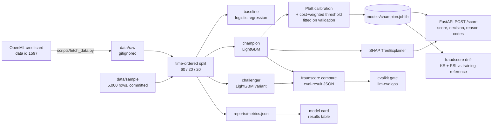

# fraud-scoring-service

Card-fraud scoring as a small, honest ML service: a time-ordered evaluation, PR-AUC as the
headline metric, a cost-weighted alert threshold, per-decision SHAP reason codes, drift
monitoring, a generated model card, a champion/challenger gate and a `/score` API with a
stated latency budget.

## Problem

A bank needs a card-fraud score that is accurate at the top of the alert queue, explainable per
decision, monitored for drift, and served inside a latency budget. Fraud is rare (about 0.17%
of transactions here), so accuracy and ROC-AUC say little: the useful questions are "of the
alerts analysts review, how many are fraud" and "how much does a wrong call cost".

## Architecture



Layout: `src/fraudscore/` (library and Typer CLI), `scripts/` (data fetch, synthetic stream,
model card, results table, latency bench, demo), `monitoring.yaml` (drift thresholds),
`evals.yaml` (gate thresholds), `reports/` (everything generated), `data/SOURCES.md`.

## How to run

Requires [uv](https://docs.astral.sh/uv/). The sibling repo `../llm-evalops` must exist next to
this one: `evalkit` (its gate CLI) is an editable path dependency, the same arrangement as in
`docs-rag`.

```bash
make setup        # Python 3.12 toolchain + dependencies
make demo         # offline end to end on the committed 5,000-row sample (about 20 s)

make data         # download the full dataset into data/raw/ (needs network, about 70 MB of parquet plus the OpenML cache)
make train        # train on the full data, writes models/ and reports/metrics.json (about 1 min)
make card         # reports/model_card.md
make bench        # p95 /score latency -> reports/bench.json
make results      # reports/results.md and the table below
make serve        # http://localhost:8000/docs
make test lint
```

`make` is only a thin wrapper; each target is one `uv run ...` line you can run by hand. On
Windows without `make`, run the commands in the `Makefile` directly.

Score a transaction:

```bash
curl -s localhost:8000/score -H 'content-type: application/json' \
  -d '{"V1":-1.36,"V2":-0.07,"V3":2.54,"V4":1.38,"V5":-0.34,"V6":0.46,"V7":0.24,"V8":0.10,
       "V9":0.36,"V10":0.09,"V11":-0.55,"V12":-0.62,"V13":-0.99,"V14":-0.31,"V15":1.47,
       "V16":-0.47,"V17":0.21,"V18":0.03,"V19":0.40,"V20":0.25,"V21":-0.02,"V22":0.28,
       "V23":-0.11,"V24":0.07,"V25":0.13,"V26":-0.19,"V27":0.13,"V28":-0.02,"Amount":149.62}'
```

The response carries `score` (calibrated probability), `decision` (`alert` or `allow` at the
chosen threshold), `reasons` (top five SHAP contributions) and `model_version`. Send
`{"transactions": [...]}` for a batch (limit `MAX_BATCH`). `GET /health`, `GET /model`.

CLI:

```bash
uv run fraudscore train | evaluate | score-file in.parquet --output out.parquet
uv run fraudscore drift new_batch.parquet          # writes reports/drift-<date>.md
uv run fraudscore compare                          # champion vs challenger, promotion gate
```

Configuration is read from the environment or `.env` (see `.env.example`): `COST_FP`,
`COST_FN`, `SEED`, rate limits, paths.

## Results

Generated by `scripts/results_table.py` from `reports/metrics.json` (written by `make train`)
and `reports/bench.json` (written by `make bench`). No number in this table is typed by hand.

<!-- results:start -->
| Metric (test split) | Baseline (logistic regression) | Champion (LightGBM) | Challenger (LightGBM, no reweighting) |
|---|---|---|---|
| PR-AUC, 95% bootstrap CI | 0.741 [0.626, 0.851] | 0.783 [0.692, 0.864] | 0.761 [0.660, 0.843] |
| ROC-AUC (reported, not optimised) | 0.982 | 0.962 | 0.985 |
| Precision @ top 1% | 0.114 | 0.111 | 0.114 |
| Recall @ top 1% | 0.867 | 0.840 | 0.867 |
| Precision @ top 0.1% | 0.895 | 0.895 | 0.842 |
| Recall @ top 0.1% | 0.680 | 0.680 | 0.640 |
| Chosen threshold (calibrated probability) | 0.0154 | 0.0435 | 0.0202 |
| Expected cost per 10k transactions (FP 5, FN 150) | 469.6 | 444.2 | 454.7 |
| Brier score (calibrated) | 0.000465 | 0.000468 | 0.000506 |
| Train time (s, CPU) | 0.6 | 6.1 | 2.1 |
| p95 `/score` latency | n/a | 20.8 ms (with reason codes) | n/a |

Data: `creditcard.parquet`, 284,807 rows, 492 frauds. Time-ordered 60/20/20 split; the test split has 56,962 rows and 75 frauds (0.132%). Seed 42, 1000 bootstrap resamples. Champion version `champion-20a4a933`. Generated 2026-11-06 by `scripts/results_table.py` from `reports/metrics.json` and `reports/bench.json`.
<!-- results:end -->

Reading the table honestly: the champion's PR-AUC interval overlaps the baseline's and the
challenger's, so with this few test frauds the models are not separable at 95% confidence.
The champion is kept because it is best on the primary metric and on expected cost, not
because the gap is proven.

Related generated files: [`reports/model_card.md`](reports/model_card.md),
[`reports/compare.md`](reports/compare.md) (champion vs challenger gate),
[`reports/drift-2026-11-07.md`](reports/drift-2026-11-07.md) (shifted synthetic stream),
`reports/shap_importance.png`, `reports/calibration.png`, `reports/pr_curve.png`.

### Reproducing the numbers

The numbers above come from the full dataset. CI trains on the committed sample instead and
gates on `reports/baseline-sample.json`; sample metrics are not comparable with the table
because the sample is fraud-enriched (5% against 0.17%).

## Leakage traps this repo avoids

- **Random splits.** Shuffling puts later transactions in training and earlier ones in
  test, so the model sees the future. The split is by `Time` order and the test split is strictly
  later than validation, which is strictly later than training.
- **Tuning on the test split.** Early stopping, calibration and the threshold are all fitted on
  validation. The test split is scored once per model.
- **`Time` as a feature.** An elapsed-time counter lets trees memorise the training window.
  `Time` orders the split and is excluded from the features.
- **Resampling before splitting.** There is no SMOTE or undersampling; imbalance is handled by
  a damped positive-class weight inside training only.
- **Duplicate timestamps across a boundary.** Split boundaries move forward so equal
  timestamps never straddle two splits.
- **Calibrating and measuring on the same rows.** Brier is reported on the test split, with the
  calibrator fitted on validation.

## Known limitations

- **No `Time` column in OpenML 1597.** It was dropped from this copy. Rows keep their original
  chronological order, so the row position is the ordinal clock (see `data/SOURCES.md`).
  Results are not in elapsed seconds and the two-day span cannot be sliced by hour.
- **Few frauds.** The test split holds a few dozen frauds, so precision and recall at the top
  0.1% rest on a handful of cases. Read the bootstrap interval, not the point estimate.
- **Two days, one issuer population.** Nothing here shows the model holds up in other months,
  regions or merchant mixes.
- **PCA features.** Reason codes name components (`V14`), not human-readable causes, and the
  model cannot be audited for protected attributes or proxies.
- **Assumed costs.** `COST_FP=5` and `COST_FN=150` are illustrative configuration, not data
  from a bank. The chosen threshold and cost figures move with them.
- **Latency is measured on one local machine**, single worker, sequential client, CPU. It is
  evidence for the budget, not a capacity plan.
- **Label delay is not simulated.** Evaluation uses fully resolved labels; production labels
  arrive late (see design note 4).
- **Drift is covariate and score drift only.** KS and PSI cannot see a change in the
  fraud-given-features relationship; that needs labels.
- **CI gate tolerance.** The sample baseline was produced on Windows; LightGBM can differ
  slightly across platforms, so the gate uses a `max_drop` tolerance rather than equality.
- **Docker image is not built here.** The Dockerfile is written but unbuilt (Docker was not
  running), so treat it as untested.

## Design notes

**1. Why a time-based split?** Fraud patterns change as fraudsters adapt, and a deployed model
only ever scores transactions that happen after its training data. A random split lets the
model learn from rows adjacent in time to each test row (same cardholder bursts, same attack
campaign), which inflates every metric. Splitting by time answers the real question: how well
does a model trained on the past rank the next stretch of transactions. It also gives the
validation split a job (early stopping, calibration, threshold) that does not touch test.

**2. Why PR-AUC and not ROC-AUC?** With roughly one fraud in 600 transactions, ROC-AUC rewards
ranking the huge legitimate majority and can stay high while most alerts are false.
Precision-recall focuses on the positive class: PR-AUC (average precision) falls when the
top of the ranking fills with legitimate cards, which is exactly what costs an analyst time.
ROC-AUC is still reported so it can be compared with other write-ups, but it is never
optimised. Precision and recall at the top 1% and 0.1% translate the ranking into queue
terms.

**3. How was the threshold chosen, and what are the cost assumptions?** Two costs are
configured: `COST_FP`, the price of an analyst reviewing a legitimate alert (default 5), and
`COST_FN`, the average loss on a missed fraud (default 150, the same order as the mean fraud
amount in the data, about 122, plus handling). After Platt calibration the model emits probabilities, and the
threshold is the cut on the validation split that minimises
`FP x COST_FP + FN x COST_FN`. Expected cost per 10,000 transactions is then reported on test.
Changing the ratio of the two costs changes the threshold, and the unit tests check that a
higher miss cost never raises it. The numbers are assumptions; the mechanism is the
deliverable. If the real ratio is unknown, report cost across a range of ratios rather than
one point.

**4. Label delay and retraining.** Fraud labels come from chargebacks and customer reports,
often days or weeks after the transaction. A model retrained on yesterday's data sees
recent frauds labelled as legitimate, which biases it toward under-alerting. In production I
would train on a window that ends one label-maturity period in the past, keep the validation
split later than the training window, and retrain on a schedule plus on a drift alert. Each
candidate goes through `fraudscore compare` and the gate: it replaces the champion only if
PR-AUC does not drop beyond the tolerance and expected cost does not rise. Drift on inputs
and scores is the early-warning signal while labels are still maturing.

**5. Why SHAP reason codes rather than LIME?** The champion is a tree ensemble, and
`TreeExplainer` computes exact Shapley values for it in milliseconds with no sampling, so the
reason codes are deterministic and sum to the model's log-odds output (a unit test checks
this). LIME fits a local surrogate to random perturbations: it is slower per request, differs
between runs unless seeded, and its perturbations of PCA features can land in regions with no
real data. SHAP also gives the global importance plot from the same values. The caveat: SHAP
explains the model, not the world, and with anonymised PCA inputs the names are only
labels. Path-dependent explanations are used so that scoring one row stays fast; the
2,000-row background sample drives the global importance plot.

## Data and licence

OpenML `creditcard` (ULB / Worldline), ODbL v1.0; source, licence and download date are in
[`data/SOURCES.md`](data/SOURCES.md). Code is MIT.
